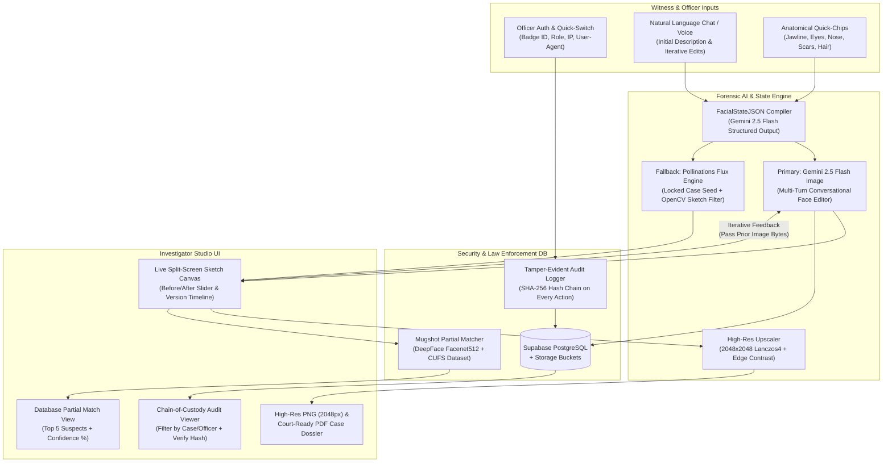
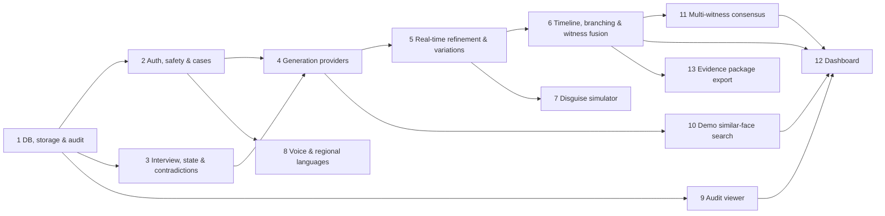

# AI Crime Scene Sketch Generator from Witness Description (PS-01)

## Problem Statement

Police departments face a severe operational bottleneck during the critical early hours of an investigation: a shortage of trained forensic sketch artists. While a witness may vividly recall a suspect's facial structure immediately after an incident, translating that natural-language recollection into an actionable forensic composite traditionally requires scheduling a specialist artist. Every hour of delay allows suspects to flee the jurisdiction and causes witness memory to decay or become contaminated (the cognitive "verbal overshadowing" and memory fade effect).

To solve this, **ForensicSketch AI (PS-01)** acts as an **on-demand, AI-powered digital forensic composite artist** built for law enforcement officers and eyewitnesses. Instead of generating disconnected random faces on every prompt, the system maintains a **persistent facial feature state** and uses **multi-turn conversational image editing** so a witness can describe a suspect in plain English, see an immediate forensic sketch, and iteratively adjust isolated anatomical features ("make the jawline more square," "narrow the eyes," "add a diagonal scar on the left cheek") while preserving the underlying identity.

Additionally, because forensic composites are sensitive evidentiary records, every single interaction—opening a case file, generating an initial composite, refining a facial trait, exporting a high-resolution sketch, or running a partial match against an authorized mugshot database—must be recorded in a **strict, tamper-evident access audit log** with cryptographic hash chaining.

## Expanded Feature Scope: New Demonstration and Investigation Capabilities

The following features are now part of the implementation scope. They must be implemented as connected backend, data, AI, and frontend behavior rather than as visual mockups.

| Feature | What the system must do | Primary phase |
| :--- | :--- | :--- |
| Memory-aware witness interview / AI-powered interview mode | Ask one focused anatomical question at a time, remember previous answers, avoid leading questions, and let the officer pause or skip a question | Phase 3 |
| Multiple suspect variations | Generate labeled Variations A, B, and C from uncertain or ambiguous witness evidence; let the witness select, compare, or keep more than one | Phase 5 |
| Timeline memory reconstruction | Accept later witness sessions, attach new statements to the case timeline, and create a new branch without overwriting earlier evidence | Phase 6 |
| Explainable AI | Show the exact requested change, affected anatomical field, before value, after value, confidence, and image-diff summary | Phases 3 and 6 |
| Audit log, voice input, and regional languages | Hash-chain every action; transcribe speech; support English, Kannada, Hindi, Marathi, and the original-language transcript | Phases 2, 8, and 12 |
| Contradiction detection and stress adaptation | Detect incompatible or uncertain statements, explain the warning, and generate alternatives instead of silently choosing one answer | Phase 3 |
| Disguise simulator | Create clearly labeled non-evidentiary variants such as with/without cap, glasses, or beard from a selected iteration | Phase 7 |
| Similar-face demo search | Search only the seeded demonstration database, return partial matches with explainable scores, and never present a match as proof of identity | Phase 10 |
| Collaborative witness fusion | Keep witness sessions separate, show agreement and disagreement, and create a weighted consensus state only after officer confirmation | Phase 11 |
| Real-time refinement | Stream progress/status and update the canvas without losing the prior iteration or its audit record | Phase 5 |
| Case evidence package export | Include case metadata, source statements, translations, confidence, variations, changes, matches, and audit verification in one PDF | Phase 13 |
| Ethical safe AI | Block celebrity/public-figure targeting, arbitrary misuse, unsafe prompts, and unauthorized biometric searches; explain the block | Phase 2 |
| Smart investigation dashboard | Put the current sketch, witness confidence, timeline, audit status, variations, matches, and warnings on one role-aware screen | Phase 12 |

These features are assistance for investigation and documentation, not identity proof. Every match, generated variation, and AI conclusion must be labeled as a lead or working hypothesis.

## Baseline & Free-Tier Resource Strategy (Google Pro + GitHub Pro + Zero-Cost Stack)

Before building the application, it is critical to map out the exact capabilities available through the developer's **Google Pro / Google AI Studio** ecosystem, **GitHub Pro** account, and open-source forensic datasets so the entire system runs at **$0 cost** with zero paywalls during the hackathon.

### AI & Cloud Capabilities Leveraged

* **Google AI Studio & Google GenAI SDK (`google-genai`):**
  * **Conversational Image Generation & Editing (`gemini-2.5-flash-image` / Nano Banana & `gemini-3-pro-image`):** Native multimodal image generation and multi-turn conversational image editing via the [Google AI Studio Gemini Image API](https://ai.google.dev/gemini-api/docs/image-generation). Passing the previous iteration's image bytes alongside the witness's refinement instruction edits only the target facial feature while keeping the rest of the face intact.
  * **Structured Facial Feature Compiler (`gemini-2.5-flash`):** Ultra-fast text/structured-output model on the [Google AI Studio Free Tier](https://ai.google.dev/gemini-api/docs/pricing) that parses conversational witness statements into a canonical `FacialStateJSON` object (14 anatomical regions) using Pydantic `response_schema`.
* **Zero-Key Deterministic Fallback (`Pollinations.ai` Flux Engine):**
  * If rate limits are ever reached during live judging, the backend automatically falls back to the open-source [Pollinations.ai Image API](https://gen.pollinations.ai/docs) (`model=flux`) using the compiled `FacialStateJSON` prompt and a **locked integer `seed`** per case file so iterative edits maintain structural consistency.
* **GitHub Pro & Student Developer Ecosystem:**
  * **Vibe-Coding Acceleration ([GitHub Copilot Pro](https://github.com/features/copilot)):** Unlimited agentic completions inside Cursor or Antigravity, plus **GitHub Codespaces Pro** (180 core-hours/month) if the team needs a cloud container to run Python `DeepFace` without local GPU/CPU lag.
  * **Important Deprecation Note:** The legacy [GitHub Models Inference API](https://docs.github.com/en/github-models) was retired in July 2026; all LLM and image calls must route through `google-genai` (Gemini API) and Pollinations rather than `models.inference.ai.azure.com`.
* **Database, Authentication & File Storage ([Supabase Free Tier](https://supabase.com/pricing)):**
  * Provides 500 MB PostgreSQL database storage, Row-Level Security (RLS), Officer JWT Authentication, and 1 GB of object storage (`forensic-sketches` and `mugshot-db` buckets) with zero credit card required.
* **Authorized Mugshot Matching Engine ([DeepFace](https://github.com/serengil/deepface) + [CUHK Face Sketch Database (CUFS)](https://www.kaggle.com/datasets/arbazkhan971/cuhk-face-sketch-database-cufs)):**
  * Uses the open-source `DeepFace` library (`ArcFace` / `Facenet512` embeddings) running locally in FastAPI against 100 pre-seeded photo/sketch pairs from the CUFS dataset and [Labeled Faces in the Wild (LFW)](https://www.kaggle.com/datasets/jessicali9530/lfw-dataset).

### What Must Carry Forward Across All Phases

Every module generated by Cursor or Antigravity must enforce these core invariants:

1. **Identity-Preserving Iterative Refinement:** Follow-up chat prompts must never generate a random new face; they must pass the prior image bytes (for Gemini conversational image editing) and the locked `case_seed` + updated `FacialStateJSON` (for deterministic fallback).
2. **100% Audit Coverage (Zero Unlogged Reads/Writes):** Every case view, sketch generation, feature refinement, mugshot search, and high-res export must write an immutable row to `access_audit_logs` before returning data to the client.
3. **Cryptographic Chain of Custody:** Each row in `access_audit_logs` computes a `row_hash = SHA256(prev_hash + officer_id + case_id + action_type + timestamp + metadata_json)` so any database tampering is immediately detectable in the UI.
4. **High-Resolution Export Pipeline:** The final exported sketch must be upscaled and sharpened to a minimum of `2048x2048` PNG (and downloadable as a complete Forensic Case PDF Dossier via [jsPDF](https://github.com/parallax/jspdf)).
5. **Dual-Mode Input (Natural Language + Anatomical Quick-Chips):** Witnesses can either type/speak freely in natural language OR click structured anatomical adjustment chips (derived from [CelebA](https://www.kaggle.com/datasets/bzhbzh35/celeba-for-face-detection) facial attributes).
6. **Non-Destructive Version Timeline:** Every refinement creates a new `sketch_iterations` record (`iteration_number = 1, 2, 3...`). Officers can revert to any earlier iteration or compare Iteration $N-1$ vs. Iteration $N$ with a side-by-side slider.
7. **Graceful AI Provider Fallback:** If `gemini-2.5-flash-image` times out or hits a quota limit, the backend transparently switches to the locked-seed Flux pipeline + OpenCV pencil-sketch filter within the same request without crashing the UI.
8. **Evidence-Preserving Uncertainty:** Uncertain, skipped, translated, contradictory, and later-added witness statements are stored with their source, confidence, language, timestamp, and speaker; the system never silently overwrites an earlier statement.
9. **Explainable Changes:** Every generated image has a machine-readable change set containing the requested text, parsed fields, before/after values, confidence, provider, and parent iteration.
10. **Safe and Authorized Use:** Safety screening, role-based access, consent/notice records, rate limits, and demo-dataset boundaries apply before image generation, matching, export, or collaboration.
11. **No Identity Claims:** Similarity scores are ranked investigative leads only; the UI, API, and PDF must not call them identifications or imply criminality from a resemblance.

## Design Decisions

All architectural questions have been resolved so you can vibe-code the entire repository end-to-end without ambiguity.

### Iterative Face Generation & Identity Locking

* **Multi-turn image-to-image editing is the primary engine.** When Iteration 1 is generated from the witness's initial description, the raw PNG bytes are stored in Supabase Storage (`forensic-sketches/{case_id}/iter_1.png`) and cached locally. When the witness submits a refinement ("make the jawline sharper and eyes smaller"), the backend sends **both** the `iter_1.png` image bytes and the edit instruction to `gemini-2.5-flash-image` with explicit instructions to preserve all unmentioned facial features, lighting, pose, and graphite sketch texture.
* **Canonical `FacialStateJSON` tracks cumulative anatomy.** Alongside the image, the backend maintains a structured JSON state of 14 facial regions (`head_shape`, `hair`, `forehead`, `eyebrows`, `eyes`, `ears`, `nose`, `cheeks`, `jawline_chin`, `mouth_lips`, `facial_hair`, `skin_texture_age`, `scars_marks`, `accessories`). Each chat turn updates only the modified keys.
* **Locked `seed` per case file.** Every case is assigned a deterministic 32-bit integer `seed` at creation time. This seed is passed to all generation calls so even if the officer switches render styles (e.g., Graphite Pencil Sketch vs. Charcoal Composite vs. Photorealistic ID), the underlying craniofacial proportions stay anchored.

### Render Modes & High-Resolution Upscaling

* **Three forensic render presets.** Officers can toggle between:
  1. `forensic_graphite` (Default): Hand-drawn police forensic graphite pencil composite on textured white paper, frontal mugshot pose, neutral expression.
  2. `charcoal_shaded`: High-contrast charcoal forensic shading emphasizing bone structure and deep shadows.
  3. `photorealistic_id`: Realistic frontal studio portrait for cross-modality mugshot matching.
* **True high-resolution export (`2048x2048` PNG + PDF Dossier).** Base iterations generate at `1024x1024` for sub-4-second real-time responsiveness during witness interviewing. When the officer clicks **"Export High-Res Sketch"**, the backend runs a Lanczos4 `2048x2048` upscale + unsharp mask edge enhancement (via Pillow/OpenCV) and generates both a standalone `2048x2048` PNG and a court-ready PDF Case Dossier containing the sketch, witness transcript, anatomical breakdown, and SHA-256 audit certificate.

### Strict Access Audit Log & Security Architecture

* **Role-Based Officer Context.** Every session requires an authenticated Officer profile (`badge_number`, `full_name`, `rank`, `department`, `role` in `['investigator', 'forensic_specialist', 'supervisor']`). For rapid hackathon demoing, the login screen includes 3 one-click **"Demo Officer Quick-Switch"** buttons so judges can immediately test how different officers appear in the audit log.
* **Append-only audit table with hash verification.** The `access_audit_logs` table records `officer_id`, `badge_number`, `case_id`, `action_type`, `resource_target`, `ip_address`, `user_agent`, `details_json`, `prev_hash`, and `row_hash`.
* **Live "Verify Chain Integrity" button in the UI.** The Audit Log screen includes a one-click verification button that recalculates every SHA-256 hash in the chain and displays a green **"Chain of Custody Verified (0 Tampered Records)"** badge—a standout visual feature for hackathon judges.

### Law Enforcement Database Partial Match (Optional Bonus Built-In)

* **Pre-seeded 100-record Mugshot Database.** A setup script (`backend/scripts/seed_cufs_mugshots.py`) populates the local `data/mugshots/` directory and `mugshot_database` table with 100 frontal faces (from CUFS / LFW) paired with synthetic criminal record metadata (`record_id`, `full_name`, `dob`, `prior_offenses`, `last_known_location`, `status`).
* **Embedding-based similarity scoring.** When the officer clicks **"Run Database Match"**, the backend computes the 512-dimensional facial embedding of the current sketch using `DeepFace.represent(model_name="Facenet512", detector_backend="opencv")` (with an automatic OpenCV ORB/Histogram + Structural Similarity fallback if TensorFlow weights are still downloading) and ranks the top 5 partial matches with similarity percentages (`65% - 96%`) and side-by-side landmark overlays.

## Solution: The Forensic Sketch & Audit System

### High-Level Architecture



## User Flow

### 1. Officer Login & Case Initialization (With Automatic Audit Trigger)

The officer opens the web application and signs in using their badge credentials (or selects one of the 3 pre-configured Demo Profiles: *Det. Vikram Rao — Badge #KA-4091*, *Forensic Analyst Priya Nair — Badge #KA-1182*, or *Supt. Arjun Mehta — Badge #KA-0045*).

* When the officer clicks **"Create New Case"** or opens an existing case (e.g., `CASE-2026-0891: Armed Robbery at MG Road`), the backend immediately writes an `OPENED_CASE_FILE` entry to `access_audit_logs`.
* At case creation, the officer enters:
  * **Case Number & Title** (auto-generated or custom)
  * **Incident Location & Timestamp**
  * **Witness Identifier / Pseudonym** (e.g., `Witness W-01 (Store Cashier)`)
  * **Initial Render Mode** (`Forensic Graphite Sketch`, `Charcoal Composite`, or `Photorealistic ID`)

### 2. Initial Witness Description & Anatomical Quick-Trait Matrix

Inside the **Split-Screen Sketch Studio**, the left panel houses the **Witness Refinement Chat & Trait Matrix**, while the right panel houses the **Interactive Forensic Canvas**.

* The witness describes the suspect in natural language (via text input or browser Web Speech API microphone button):
  > *"He was a male in his mid-30s, gaunt oval face, thick bushy eyebrows, narrow almond eyes, a crooked hooked nose, a sharp square jawline, stubble beard, and a small vertical scar above his right eyebrow."*
* Below the chat box, expandable **Anatomical Quick-Chips** let the officer click common traits (`Square Jaw`, `Hooked Nose`, `Deep-Set Eyes`, `Receding Hairline`, `Left Cheek Scar`, `Wire-Rim Glasses`) to append structured refinements with one click.
* Clicking **"Generate Initial Composite (Iteration #1)"**:
  1. Compiles the description into a 14-field `FacialStateJSON` object via `gemini-2.5-flash`.
  2. Generates the `1024x1024` frontal forensic sketch via `gemini-2.5-flash-image` (or locked-seed Flux fallback).
  3. Saves Iteration #1 to `sketch_iterations` and logs `GENERATED_INITIAL_SKETCH` in `access_audit_logs`.

### 3. Real-Time Iterative Refinement Chat (Multi-Turn Feature Editing)

Once Iteration #1 is displayed on the canvas, the witness provides iterative corrections:

* **Witness Feedback #1:** *"The jawline is too wide—make the chin narrower and more pointed, and make his eyes slightly wider apart."*
* **What happens under the hood:**
  1. `FacialStateJSON` updates `jawline_chin` from `"sharp square jawline"` to `"narrow pointed chin with tapered jawline"` and `eyes` to `"narrow almond eyes set slightly wider apart"`, while keeping all other 12 facial regions locked.
  2. The backend passes the **exact image bytes of Iteration #1** + the targeted delta prompt to `gemini-2.5-flash-image` (`"Edit this exact forensic sketch: make the chin narrower and more pointed, and set the eyes slightly wider apart. Keep the crooked hooked nose, thick bushy eyebrows, vertical scar above right eyebrow, hair, lighting, and pencil sketch style completely unchanged."`).
  3. Iteration #2 renders in ~3 seconds and appears in the canvas with an interactive **Before / After Comparison Slider** (Iteration #1 vs. Iteration #2).
  4. The backend records `REFINED_FACIAL_FEATURE` in `access_audit_logs` along with the exact JSON diff of which anatomical traits changed.

### 4. Version History Timeline & Non-Destructive Branching

At the bottom of the canvas, a horizontal **Iteration Timeline Strip** displays thumbnails for `Iter #1`, `Iter #2`, `Iter #3`, etc., along with the witness quote that produced each version and a self-reported **Witness Likeness Rating (1–10 slider)**. If a refinement goes in the wrong direction, the officer can click any prior iteration thumbnail and click **"Branch From Here"** to continue refining from that earlier face.

### 5. Authorized Law Enforcement Database Partial Match

When the witness is satisfied with the composite (e.g., Likeness Rating $\ge 8/10$), the officer clicks **"Run Law Enforcement DB Match"**:

1. The backend logs `EXECUTED_MUGSHOT_SEARCH` in `access_audit_logs` (recording the officer badge, case ID, and iteration ID).
2. The matcher compares the sketch against the authorized `mugshot_database` (pre-seeded with CUHK Face Sketch Database & LFW records).
3. A modal displays the **Top 5 Partial Matches**, showing each suspect's mugshot, full name, criminal record ID, prior offenses, facial feature overlap tags, and a **Similarity Confidence Score (e.g., 89.4% Match)**.
4. The officer can click **"Flag as Potential Lead"** on any match, which attaches the suspect record to the case file and writes `FLAGGED_SUSPECT_MATCH` to the audit log.

### 6. High-Resolution Export & Tamper-Evident Audit Log Inspection

1. Clicking **"Export High-Res Sketch (2048px PNG)"** runs the backend Lanczos4 upscaler + forensic contrast sharpener, streams the `2048x2048` PNG to the browser, and logs `EXPORTED_HIGH_RES_SKETCH`.
2. Clicking **"Export Official Case Dossier (PDF)"** generates a multi-section forensic report via `jsPDF` containing the high-res sketch, case metadata, complete chronological refinement transcript, 14-point `FacialStateJSON` table, flagged database matches, and the cryptographic SHA-256 audit log hash.
3. Switching to the **"Access Audit Log & Chain of Custody"** tab shows the real-time security table with filters by Case ID, Officer Badge, Action Type, and Date Range, plus the **"Verify SHA-256 Hash Chain"** button.

## Facial Feature Taxonomy & Refinement Operations

Every witness description and refinement is parsed into these 14 canonical anatomical regions inside `FacialStateJSON`.

| Anatomical RegionKey | Purpose & Scope | Example Witness Prompt | AI Refinement Strategy | Fallback if Unspecified |
| :--- | :--- | :--- | :--- | :--- |
| `age_gender_ethnicity` | Base craniofacial proportions | *"Male, late 30s, South Asian"* | Anchors skin tone, bone maturity, and base proportions | `"Adult male, approximately 30-35 years old"` |
| `head_face_shape` | Outer cranial silhouette | *"Long gaunt oval face with hollow cheeks"* | Modifies outer contour (`oval`, `square`, `round`, `heart`, `diamond`, `oblong`) | `"Balanced oval face shape"` |
| `hair_style_texture` | Scalp hair length, parting, texture | *"Short cropped curly black hair, receding at temples"* | Edits upper cranium and hairline without altering facial landmarks | `"Short neat dark hair"` |
| `forehead` | Upper third height and brow ridge | *"High wide forehead with horizontal worry lines"* | Adjusts distance between hairline and glabella | `"Medium height smooth forehead"` |
| `eyebrows` | Shape, thickness, arch, spacing | *"Very thick, bushy, straight eyebrows close together"* | Refines supraorbital ridge hair density and angle | `"Natural medium-thickness eyebrows"` |
| `eyes` | Shape, size, spacing, eyelids, gaze | *"Narrow hooded almond eyes with dark bags underneath"* | Modifies palpebral fissure, epicanthic/hooded fold, and periorbital shadows | `"Standard almond-shaped eyes, neutral gaze"` |
| `nose` | Bridge, width, tip, nostrils | *"Broad crooked nose bridge with a hooked downward tip"* | Edits nasal dorsum, alar base width, and nasal tip projection | `"Straight medium-width nose"` |
| `cheeks` | Zygomatic arch prominence | *"High prominent cheekbones, sunken lower cheeks"* | Adjusts mid-face shading and contour lines | `"Natural medium cheekbones"` |
| `jawline_chin` | Mandibular angle and mental protuberance | *"Wide square jaw with a deep cleft chin"* | Alters lower third width, gonial angle, and chin shape | `"Moderate tapered jawline and rounded chin"` |
| `mouth_lips` | Lip fullness, width, philtrum, corners | *"Thin upper lip, fuller lower lip, slightly upturned corners"* | Edits vermilion border and oral commissures | `"Medium balanced lips, neutral expression"` |
| `ears` | Size, protrusion, lobes | *"Large protruding ears with attached earlobes"* | Modifies lateral pinna silhouette | `"Normal proportioned ears close to head"` |
| `facial_hair` | Mustache, beard, stubble | *"Heavy 5-o'clock shadow stubble and thick handlebar mustache"* | Overlays hair texture on lower face while keeping jaw contour | `"Clean-shaven"` |
| `scars_marks_tattoos` | Forensic identifying marks | *"2-inch diagonal knife scar across left cheek and mole near right lip"* | High-priority localized landmark injection | `"No visible scars, moles, or tattoos"` |
| `accessories` | Eyewear, headwear, piercings | *"Thin rectangular silver prescription glasses and small left ear stud"* | Renders non-occluding forensic accessories | `"No glasses, hats, or jewelry"` |

## Forensic Render Style Intelligence

Stored in `backend/services/facial_state_engine.py` as `RENDER_STYLE_INTELLIGENCE` and injected into every image generation/editing call so outputs look like authentic police composite drawings rather than generic AI art.

* **`forensic_graphite` (Default Police Sketch):**
  * **Positive Style Prompt:** `"Authentic police forensic artist composite sketch, hand-drawn with 2B and 4B graphite pencils on clean white cartridge paper, precise anatomical hatching and cross-hatching, frontal mugshot passport view, neutral expression, symmetrical studio lighting, sharp facial landmarks, monochrome greyscale."`
  * **Negative Constraints:** `"No color, no dramatic cinematic angles, no 3D CGI plastic skin, no background clutter, no watermarks, no text labels, no cropped forehead or chin."`
* **`charcoal_shaded` (High-Contrast Forensic Charcoal):**
  * **Positive Style Prompt:** `"High-contrast forensic charcoal and conte crayon portrait composite, deep anatomical shading emphasizing cheekbones, orbital sockets, and jawline, frontal mugshot view, textured off-white sketch paper, monochrome."`
* **`photorealistic_id` (Photorealistic Suspect Reconstruction):**
  * **Positive Style Prompt:** `"Photorealistic police identification frontal mugshot portrait, neutral grey background, flat even studio lighting, natural skin pores and realistic hair strands, looking directly at camera, 85mm lens."`

## Strict Access Audit Log & Chain of Custody

Every action on a case file is logged in the `access_audit_logs` table with an immutable SHA-256 hash chain.

### Tracked Action Types (`AuditActionType` Enum)

* `USER_LOGIN` — Officer authenticated into the forensic terminal.
* `CREATED_CASE_FILE` — New investigation case file initialized.
* `OPENED_CASE_FILE` — Officer viewed a case file and its sketch history.
* `GENERATED_INITIAL_SKETCH` — First composite sketch generated from witness baseline description.
* `REFINED_FACIAL_FEATURE` — Iterative chat or quick-chip refinement applied (stores exact `changed_fields` diff in `details_json`).
* `REVERTED_ITERATION` — Officer branched from an earlier sketch iteration.
* `UPDATED_LIKENESS_SCORE` — Witness updated the 1–10 likeness confidence rating.
* `EXECUTED_MUGSHOT_SEARCH` — Officer ran a facial similarity search against the authorized law enforcement database.
* `FLAGGED_SUSPECT_MATCH` — Officer linked a database mugshot match as an investigative lead on the case.
* `EXPORTED_HIGH_RES_SKETCH` — Officer downloaded the `2048x2048` high-resolution PNG sketch.
* `EXPORTED_CASE_DOSSIER_PDF` — Officer exported the complete PDF evidentiary package.
* `VERIFIED_AUDIT_CHAIN` — Supervisor or auditor ran a cryptographic integrity check on the audit log.

### Cryptographic Hash Chaining Formula

To guarantee that no record in `access_audit_logs` has been deleted or altered after the fact, each row stores `prev_hash` (the `row_hash` of the immediately preceding audit entry, or `"0" * 64` for the genesis entry) and computes:

$$\text{row\_hash} = \text{SHA256}\left(\text{prev\_hash} \parallel \text{officer\_id} \parallel \text{case\_id} \parallel \text{action\_type} \parallel \text{created\_at\_iso} \parallel \text{canonical\_json(details\_json)}\right)$$

When the judge or supervisor clicks **"Verify Chain Integrity"**, the backend iterates through all rows ordered by `seq_id ASC`, recomputes every SHA-256 digest, and returns `{ "verified": true, "total_records": N, "tampered_ids": [] }`.

## Future Considerations (Post-Hackathon Roadmap)

These capabilities are documented for architectural extensibility and judge Q&A, while keeping the V1 hackathon build focused and shippable in 24–36 hours:

* **3D Craniofacial Mesh Export (`.obj` / Three.js):** Projecting the 2D frontal composite onto a 3D rotatable head mesh so witnesses can verify the suspect's 3/4 profile and side nose bridge projection.

# Technical Implementation Plan

## Phase Overview



| Phase | Description | Dependencies | Key Files |
| :--- | :--- | :--- | :--- |
| **1** | Database, storage, version records, witness statements, safety events, and immutable audit chain | None | `supabase/migrations/001_forensic_schema.sql`, `backend/db/database.py` |
| **2** | Officer authentication, role permissions, case CRUD, consent/notice, rate limits, and safe-AI policy screening | Phase 1 | `backend/models/schemas.py`, `backend/routers/auth.py`, `backend/routers/cases.py`, `backend/services/safety_service.py` |
| **3** | Memory-aware interview engine, `FacialStateJSON`, contradiction detection, confidence/uncertainty handling, and explainable change compiler | Phases 1, 2 | `backend/services/interview_service.py`, `backend/services/facial_state_engine.py`, `backend/services/contradiction_service.py` |
| **4** | Dual-engine sketch generation with identity locking, provider status, streaming progress, and structured failure reporting | Phases 2, 3 | `backend/services/sketch_generator.py`, `backend/services/provider_status.py` |
| **5** | Real-time refinement, non-destructive iterations, image diffs, and multiple suspect variations | Phase 4 | `backend/routers/sketches.py`, `backend/services/image_upscaler.py`, `backend/services/variation_service.py` |
| **6** | Memory-reconstruction timeline, later sessions, branch/revert behavior, and witness-statement provenance | Phase 5 | `backend/services/timeline_service.py`, `backend/routers/witness_sessions.py` |
| **7** | Clearly labeled disguise simulator derived from a selected iteration | Phase 5 | `backend/services/disguise_service.py`, `backend/routers/disguises.py` |
| **8** | Voice transcription and Kannada, Hindi, Marathi, and English language workflow with original and normalized text | Phases 2, 3 | `backend/services/transcription_service.py`, `backend/services/translation_service.py` |
| **9** | Tamper-evident SHA-256 access audit service, verification endpoint, and viewer | Phase 1 | `backend/services/audit_service.py`, `backend/routers/audit.py`, `frontend/src/components/audit/AuditLogView.tsx` |
| **10** | Authorized demonstration similar-face search with explainable partial scores and lead flagging | Phase 4 | `backend/scripts/seed_cufs_mugshots.py`, `backend/services/mugshot_matcher.py`, `frontend/src/components/matching/MatchModal.tsx` |
| **11** | Separate witness workspaces, agreement/disagreement analysis, and officer-approved consensus fusion | Phase 6 | `backend/services/witness_fusion_service.py`, `backend/routers/witness_fusion.py` |
| **12** | Smart investigation dashboard with role-aware case summary and live status panels | Phases 6, 7, 8, 9, 10, 11 | `frontend/src/components/dashboard/InvestigationDashboard.tsx` |
| **13** | High-resolution PNG and complete case evidence package PDF with provenance and audit verification | Phases 6, 7, 9, 10, 11 | `frontend/src/utils/exportDossier.ts` |

## Revised Phases in Easy English

This is the recommended build order. Each phase should be demoable and testable before the next phase begins.

### Phase 1: Store the Case Safely

Create the database tables and file storage for officers, cases, witness sessions, statements, facial states, image iterations, variations, disguises, match results, exports, and audit events. Add indexes and retention metadata so records can be found and eventually deleted according to policy. The database must preserve old versions instead of replacing them.

**Result:** The application has a reliable place to store every piece of case evidence and every action taken on it.

### Phase 2: Control Access and Prevent Unsafe Use

Add officer login, roles, permissions, demo profiles, and case-level authorization. Before processing text, audio, image generation, matching, or export, run the safe-AI policy check. Reject celebrity/public-figure requests, unauthorized searches, unsafe content, and requests outside the demo dataset. Show a clear reason for each block and audit it.

**Result:** Only an authorized officer can use the correct case features, and the system cannot be casually misused.

### Phase 3: Interview the Witness Like a Trained Interviewer

Instead of asking for one large description, the AI asks short, neutral questions such as “Were the eyebrows thick or thin?” It remembers answered questions, tracks skipped questions, accepts “not sure/maybe/possibly,” and avoids asking the same question repeatedly. It converts each answer into a structured facial state while retaining the exact original wording, language, confidence, and timestamp.

This phase also detects contradictions such as “18 years old” with “white beard.” It should not silently choose one answer. It should explain the conflict and ask a clarification question or create alternative states. Each change includes an explanation such as `eye_width: medium -> wide (+20%)`.

**Result:** The system gets better information from the witness and can explain how that information was used.

### Phase 4: Generate the First Sketch Reliably

Generate the first composite from the structured state using Gemini, then use the locked-seed Flux and local renderer fallbacks if needed. Keep the case seed, facial state, provider, prompt version, and generation status. Report progress to the UI and return a visible error state if all providers fail; never pretend that a missing image was generated.

**Result:** The witness sees a first sketch, with enough provenance to reproduce or investigate the result.

### Phase 5: Refine in Real Time and Create Alternatives

When the witness says “make the jaw sharper,” update only the jaw field, send the prior image for identity-preserving editing, and create a new iteration. Show the requested change, before/after values, confidence, and image comparison. Stream progress so the UI feels immediate while preserving the previous version.

If the witness is uncertain, generate Variations A, B, and C from explicit alternatives. Label them as possibilities, let the witness compare or select one, and keep all versions and selection reasons in the timeline.

**Result:** The sketch improves quickly without erasing history, and uncertainty becomes visible instead of being hidden.

### Phase 6: Reconstruct Memory Over Time

Allow a new witness session on Day 2 or later. A later statement such as “the jaw was sharper than I first said” creates a new branch from the chosen earlier iteration. The system shows when the statement was added, who recorded it, what changed, and which image resulted. Reverting means creating a new branch, not deleting evidence.

**Result:** Memory can be updated while the original account remains available for review.

### Phase 7: Simulate Disguises Without Confusing Evidence

From a selected composite, generate clearly marked exploration variants such as with/without a cap, glasses, or beard. Store the base iteration and the disguise operation. Disguise images must carry a visible `SIMULATION - NOT ORIGINAL WITNESS DESCRIPTION` label and must not silently replace the evidentiary composite.

**Result:** Investigators can explore practical search scenarios without confusing a simulation with witness evidence.

### Phase 8: Accept Speech and Regional Languages

Let a witness speak through the browser or upload an authorized recording. Store the original audio/transcript, language, translation, confidence, and normalized English text separately. Support English, Kannada, Hindi, and Marathi first, with a clear unsupported-language response. The officer can correct a transcription before it changes the facial state.

**Result:** Elderly witnesses and witnesses who are more comfortable in a regional language can participate accurately.

### Phase 9: Make Every Action Tamper-Evident

Write an audit record for viewing, changing, generating, matching, flagging, exporting, translating, blocking, and verifying. Chain each row to the previous SHA-256 hash. Provide filters and a verification action that identifies the exact broken record if the chain is invalid. The audit viewer must show the actor, case, time, action, source iteration, and relevant JSON diff.

**Result:** Officers and judges can see who did what and whether the record was altered.

### Phase 10: Search a Safe Demonstration Database

Search only the authorized seeded demo data. Combine visual similarity and facial-trait overlap into an explainable ranked score, show the traits that contributed, and label results as partial investigative leads. Do not expose real criminal history in a demo and do not describe a score as proof of identity. Flagging a lead requires permission and creates an audit event.

**Result:** The demo shows scalability while respecting the difference between resemblance and identification.

### Phase 11: Combine Multiple Witnesses Carefully

Give each witness a separate session and state. Compare their answers by anatomical region, show agreement and disagreement, and let an authorized officer approve a weighted consensus. Preserve each individual account and identify which witness contributed to each consensus field. Do not average incompatible statements without displaying the uncertainty.

**Result:** Two witnesses can contribute complementary observations without losing independent evidence.

### Phase 12: Show a Smart Investigation Dashboard

Create one role-aware screen containing the current sketch, witness confidence, interview progress, contradictions, timeline, alternatives, disguise simulations, similar-face leads, audit status, and pending actions. Use clear labels and warnings so an officer can understand the case without opening many pages. Supervisors can see audit and export status; witnesses should not see restricted match or officer data.

**Result:** The project feels like a complete investigation tool rather than a single image generator.

### Phase 13: Export a Complete Evidence Package

Export the selected composite as a high-resolution PNG and generate one PDF containing the case ID, witness statements and translations, confidence levels, selected and rejected variations, change explanations, timeline, matches and disclaimers, officer details, and audit-chain verification. Include hashes and timestamps so the package can be checked later. Make the image dimensions explicit, especially if a footer makes the total canvas taller than 2048 pixels.

**Result:** An officer can download one professional, reviewable case package.

## Cross-Cutting: Structured Logging, Audit Middleware, and Error Handling

Every backend endpoint and AI service must follow a deterministic logging and error-isolation pattern so you never hit silent failures during your live hackathon demo.

### Project Directory Tree

Instruct Cursor or Antigravity to scaffold this exact monorepo structure:

```text
forensic-sketch-ai/
├── .env.example
├── README.md
├── supabase/
│   └── migrations/
│       └── 001_forensic_schema.sql
├── backend/
│   ├── main.py
│   ├── config.py
│   ├── requirements.txt
│   ├── db/
│   │   └── database.py
│   ├── models/
│   │   └── schemas.py
│   ├── services/
│   │   ├── audit_service.py
│   │   ├── facial_state_engine.py
│   │   ├── sketch_generator.py
│   │   ├── image_upscaler.py
│   │   └── mugshot_matcher.py
│   ├── routers/
│   │   ├── auth.py
│   │   ├── cases.py
│   │   ├── sketches.py
│   │   ├── matching.py
│   │   └── audit.py
│   ├── scripts/
│   │   └── seed_cufs_mugshots.py
│   └── data/
│       ├── mugshots/
│       └── sketches/
└── frontend/
    ├── package.json
    ├── vite.config.ts
    ├── tailwind.config.js
    └── src/
        ├── App.tsx
        ├── main.tsx
        ├── types/
        │   └── forensic.ts
        ├── api/
        │   └── client.ts
        ├── utils/
        │   └── exportDossier.ts
        └── components/
            ├── layout/
            │   └── Navbar.tsx
            ├── cases/
            │   ├── CaseDashboard.tsx
            │   └── NewCaseModal.tsx
            ├── studio/
            │   ├── SketchStudio.tsx
            │   ├── RefinementChat.tsx
            │   ├── FeatureQuickChips.tsx
            │   ├── CanvasViewer.tsx
            │   └── IterationTimeline.tsx
            ├── matching/
            │   └── MatchModal.tsx
            └── audit/
                └── AuditLogView.tsx
```

### Structured Logging & Mandatory Audit Helper

All backend modules use a unified structured logger and call `log_audit_event()` on every state read or mutation:

```python
# backend/services/audit_service.py (Core Pattern)
import hashlib
import json
import logging
from datetime import datetime, timezone
from typing import Any, Dict, Optional
from uuid import UUID

logger = logging.getLogger("forensic_ai")

def compute_audit_hash(
    prev_hash: str,
    officer_id: str,
    case_id: Optional[str],
    action_type: str,
    timestamp_iso: str,
    details: Dict[str, Any],
) -> str:
    canonical_details = json.dumps(details, sort_keys=True, separators=(",", ":"))
    payload = f"{prev_hash}|{officer_id}|{case_id or 'GLOBAL'}|{action_type}|{timestamp_iso}|{canonical_details}"
    return hashlib.sha256(payload.encode("utf-8")).hexdigest()
```

### AI Provider Fallback Pattern

Never let a rate limit or network hiccup on one AI endpoint break a live demo. All image generation calls in `sketch_generator.py` execute in a 3-tier cascade:

1. **Tier 1 (Primary):** `google-genai` SDK calling `gemini-2.5-flash-image` (passes prior iteration PNG bytes + refinement instruction for true conversational image editing).
2. **Tier 2 (Secondary Cloud Fallback):** `Pollinations.ai` Flux endpoint (`https://gen.pollinations.ai/image/{encoded_prompt}?model=flux&seed={case_seed}&width=1024&height=1024&nologo=true`) + OpenCV pencil-sketch adaptive contrast post-processing.
3. **Tier 3 (Offline Emergency Fallback):** Local deterministic OpenCV procedural composite renderer so even if venue Wi-Fi drops completely, the UI still renders a valid image and logs the audit trail.

## Phase 1: Database Schema & Dual-Mode Storage Setup

### Migration: `supabase/migrations/001_forensic_schema.sql`

To make local vibe-coding frictionless, `backend/db/database.py` supports **both** Supabase PostgreSQL (via `DATABASE_URL`) and an automatic zero-config local SQLite/PostgreSQL fallback via SQLAlchemy/asyncpg so the app starts immediately even before configuring cloud credentials. Run this SQL in the Supabase SQL Editor:

```sql
-- Enable UUID extension
CREATE EXTENSION IF NOT EXISTS "pgcrypto";

-- 1. Officers Table (Law Enforcement Personnel)
CREATE TABLE IF NOT EXISTS officers (
    id UUID PRIMARY KEY DEFAULT gen_random_uuid(),
    badge_number VARCHAR(50) UNIQUE NOT NULL,
    full_name VARCHAR(120) NOT NULL,
    rank VARCHAR(80) NOT NULL,
    department VARCHAR(120) NOT NULL DEFAULT 'Bengaluru City Police - Cyber & Forensic Division',
    role VARCHAR(40) NOT NULL DEFAULT 'investigator'
        CHECK (role IN ('investigator', 'forensic_specialist', 'supervisor')),
    created_at TIMESTAMPTZ NOT NULL DEFAULT NOW()
);

-- 2. Investigation Case Files
CREATE TABLE IF NOT EXISTS cases (
    id UUID PRIMARY KEY DEFAULT gen_random_uuid(),
    case_number VARCHAR(64) UNIQUE NOT NULL,
    title VARCHAR(200) NOT NULL,
    incident_date TIMESTAMPTZ NOT NULL DEFAULT NOW(),
    location VARCHAR(200) NOT NULL,
    witness_alias VARCHAR(100) NOT NULL,
    status VARCHAR(30) NOT NULL DEFAULT 'active'
        CHECK (status IN ('active', 'suspect_identified', 'closed', 'archived')),
    render_style VARCHAR(40) NOT NULL DEFAULT 'forensic_graphite'
        CHECK (render_style IN ('forensic_graphite', 'charcoal_shaded', 'photorealistic_id')),
    case_seed BIGINT NOT NULL,
    current_facial_state JSONB NOT NULL DEFAULT '{}'::jsonb,
    current_iteration_id UUID,
    lead_officer_id UUID NOT NULL REFERENCES officers(id),
    created_at TIMESTAMPTZ NOT NULL DEFAULT NOW(),
    updated_at TIMESTAMPTZ NOT NULL DEFAULT NOW()
);

CREATE INDEX idx_cases_number ON cases (case_number);
CREATE INDEX idx_cases_status ON cases (status, created_at DESC);

-- 3. Sketch Iterations (Non-Destructive Version History)
CREATE TABLE IF NOT EXISTS sketch_iterations (
    id UUID PRIMARY KEY DEFAULT gen_random_uuid(),
    case_id UUID NOT NULL REFERENCES cases(id) ON DELETE CASCADE,
    iteration_number INTEGER NOT NULL CHECK (iteration_number >= 1),
    parent_iteration_id UUID REFERENCES sketch_iterations(id),
    witness_prompt TEXT NOT NULL,
    compiled_diffusion_prompt TEXT NOT NULL,
    facial_state_snapshot JSONB NOT NULL,
    changed_traits JSONB NOT NULL DEFAULT '[]'::jsonb,
    image_url TEXT NOT NULL,
    high_res_image_url TEXT,
    ai_provider_used VARCHAR(60) NOT NULL DEFAULT 'gemini-2.5-flash-image',
    generation_latency_ms INTEGER NOT NULL DEFAULT 0,
    witness_likeness_score INTEGER CHECK (witness_likeness_score BETWEEN 1 AND 10),
    created_by_officer_id UUID NOT NULL REFERENCES officers(id),
    created_at TIMESTAMPTZ NOT NULL DEFAULT NOW(),
    UNIQUE (case_id, iteration_number)
);

CREATE INDEX idx_iterations_case ON sketch_iterations (case_id, iteration_number ASC);

-- 4. Authorized Law Enforcement Mugshot Database (Mock CUFS / LFW Records)
CREATE TABLE IF NOT EXISTS mugshot_database (
    id UUID PRIMARY KEY DEFAULT gen_random_uuid(),
    record_code VARCHAR(50) UNIQUE NOT NULL,
    full_name VARCHAR(120) NOT NULL,
    age INTEGER NOT NULL,
    gender VARCHAR(20) NOT NULL,
    height_cm INTEGER NOT NULL,
    prior_offenses TEXT[] NOT NULL DEFAULT '{}',
    last_known_area VARCHAR(150) NOT NULL,
    image_path TEXT NOT NULL,
    facial_attributes JSONB NOT NULL DEFAULT '{}'::jsonb,
    embedding_json JSONB,
    created_at TIMESTAMPTZ NOT NULL DEFAULT NOW()
);

-- 5. Strict Tamper-Evident Access Audit Log
CREATE TABLE IF NOT EXISTS access_audit_logs (
    seq_id BIGSERIAL PRIMARY KEY,
    id UUID UNIQUE NOT NULL DEFAULT gen_random_uuid(),
    officer_id UUID NOT NULL REFERENCES officers(id),
    badge_number VARCHAR(50) NOT NULL,
    officer_name VARCHAR(120) NOT NULL,
    case_id UUID REFERENCES cases(id) ON DELETE SET NULL,
    case_number VARCHAR(64),
    action_type VARCHAR(60) NOT NULL,
    resource_target VARCHAR(200) NOT NULL,
    ip_address VARCHAR(64) NOT NULL DEFAULT '127.0.0.1',
    user_agent TEXT NOT NULL DEFAULT 'ForensicTerminal/1.0',
    details_json JSONB NOT NULL DEFAULT '{}'::jsonb,
    prev_hash VARCHAR(64) NOT NULL,
    row_hash VARCHAR(64) NOT NULL,
    created_at TIMESTAMPTZ NOT NULL DEFAULT NOW()
);

CREATE INDEX idx_audit_case ON access_audit_logs (case_id, seq_id DESC);
CREATE INDEX idx_audit_officer ON access_audit_logs (officer_id, seq_id DESC);
CREATE INDEX idx_audit_action ON access_audit_logs (action_type, seq_id DESC);

-- Seed 3 Demo Officers for Instant Hackathon Testing
INSERT INTO officers (id, badge_number, full_name, rank, department, role) VALUES
    ('11111111-1111-1111-1111-111111111111', 'KA-4091', 'Det. Vikram Rao', 'Senior Inspector', 'Bengaluru Central Crime Branch', 'investigator'),
    ('22222222-2222-2222-2222-222222222222', 'KA-1182', 'Priya Nair', 'Lead Forensic Composite Specialist', 'State Forensic Science Laboratory', 'forensic_specialist'),
    ('33333333-3333-3333-3333-333333333333', 'KA-0045', 'Supt. Arjun Mehta', 'Deputy Commissioner (Audit & Compliance)', 'Internal Security & Evidence Audit', 'supervisor')
ON CONFLICT (badge_number) DO NOTHING;
```

## Phase 2: Officer Authentication, Case Setup & Pydantic Schemas

### File: `backend/models/schemas.py`

Define strict Pydantic v2 models for the 14-region `FacialStateJSON`, Case creation, Refinement requests, Mugshot matches, and Audit Log verification:

```python
from datetime import datetime
from typing import Any, Dict, List, Literal, Optional
from uuid import UUID
from pydantic import BaseModel, Field

RenderStyle = Literal["forensic_graphite", "charcoal_shaded", "photorealistic_id"]

class FacialStateJSON(BaseModel):
    age_gender_ethnicity: str = Field(default="Adult male, approximately 30-35 years old")
    head_face_shape: str = Field(default="Balanced oval face shape")
    hair_style_texture: str = Field(default="Short neat dark hair")
    forehead: str = Field(default="Medium height smooth forehead")
    eyebrows: str = Field(default="Natural medium-thickness eyebrows")
    eyes: str = Field(default="Standard almond-shaped eyes, neutral gaze")
    nose: str = Field(default="Straight medium-width nose")
    cheeks: str = Field(default="Natural medium cheekbones")
    jawline_chin: str = Field(default="Moderate tapered jawline and rounded chin")
    mouth_lips: str = Field(default="Medium balanced lips, neutral expression")
    ears: str = Field(default="Normal proportioned ears close to head")
    facial_hair: str = Field(default="Clean-shaven")
    scars_marks_tattoos: str = Field(default="No visible scars, moles, or tattoos")
    accessories: str = Field(default="No glasses, hats, or jewelry")

class StateCompilationResult(BaseModel):
    updated_state: FacialStateJSON
    changed_traits: List[str] = Field(
        description="List of anatomical keys modified in this turn, e.g. ['jawline_chin', 'eyes']"
    )
    delta_edit_instruction: str = Field(
        description="Concise imperative instruction for the image editor describing only what to change while locking all other traits"
    )

class CreateCaseRequest(BaseModel):
    title: str = Field(..., min_length=3, max_length=200)
    location: str = Field(..., min_length=2, max_length=200)
    witness_alias: str = Field(..., min_length=2, max_length=100)
    render_style: RenderStyle = "forensic_graphite"

class GenerateSketchRequest(BaseModel):
    witness_prompt: str = Field(..., min_length=3, max_length=2000)
    quick_chips: List[str] = Field(default_factory=list)
    parent_iteration_id: Optional[str] = None
    render_style_override: Optional[RenderStyle] = None

class UpdateLikenessRequest(BaseModel):
    witness_likeness_score: int = Field(..., ge=1, le=10)
```

### File: `backend/routers/cases.py`

* `POST /api/cases`: Generates a unique `case_number` (e.g., `CASE-2026-XXXX`) and a random 32-bit integer `case_seed = random.randint(100000, 999999999)`, initializes an empty `FacialStateJSON`, saves the case, and calls `audit_service.log_event(action_type="CREATED_CASE_FILE")`.
* `GET /api/cases`: Lists all cases with their latest sketch thumbnail and iteration count.
* `GET /api/cases/{case_id}`: Fetches full case metadata + ordered `sketch_iterations` list, and immediately writes an `OPENED_CASE_FILE` entry into `access_audit_logs` so every single case view is audited.

## Phase 3: Facial Feature State Engine & Prompt Compiler

### New File: `backend/services/facial_state_engine.py`

This service uses `google-genai` (`gemini-2.5-flash`) with Structured Outputs (`response_schema=StateCompilationResult`) to merge each witness statement into the existing `FacialStateJSON` without losing previously described features:

```python
import os
import json
from typing import List, Tuple
from google import genai
from google.genai import types
from models.schemas import FacialStateJSON, StateCompilationResult, RenderStyle

RENDER_STYLE_INTELLIGENCE = {
    "forensic_graphite": (
        "Authentic police forensic artist composite sketch, hand-drawn with 2B and 4B graphite "
        "pencils on white cartridge paper, detailed anatomical cross-hatching, frontal mugshot "
        "passport pose, neutral expression, symmetrical studio lighting, sharp facial landmarks, "
        "monochrome greyscale sketch. No color, no 3D CGI, no text, no watermarks."
    ),
    "charcoal_shaded": (
        "High-contrast forensic charcoal composite drawing, deep anatomical shading on cheekbones "
        "and orbital sockets, frontal mugshot view, textured sketch paper, monochrome charcoal."
    ),
    "photorealistic_id": (
        "Photorealistic police identification frontal mugshot portrait, neutral grey background, "
        "flat studio lighting, realistic skin texture and pores, looking directly at camera."
    ),
}

async def compile_facial_state(
    current_state: FacialStateJSON,
    witness_prompt: str,
    quick_chips: List[str],
    is_initial: bool,
) -> StateCompilationResult:
    """
    Uses Gemini 2.5 Flash Structured Outputs to update ONLY the facial features mentioned
    by the witness while preserving all other anatomical regions verbatim.
    """
    combined_input = witness_prompt
    if quick_chips:
        combined_input += f" | Selected anatomical traits: {', '.join(quick_chips)}"

    api_key = os.getenv("GEMINI_API_KEY")
    if not api_key:
        # Deterministic rule-based parser if API key is not configured yet
        return _rule_based_state_update(current_state, combined_input, is_initial)

    try:
        client = genai.Client(api_key=api_key)
        system_instruction = (
            "You are a senior police forensic composite anatomist. "
            "Given the current 14-region FacialStateJSON of a suspect and the witness's new "
            "description or refinement feedback, update ONLY the anatomical regions mentioned "
            "by the witness. Preserve every other field in FacialStateJSON verbatim so the "
            "suspect's identity never drifts. Return the updated state, the list of modified "
            "field keys in changed_traits, and a concise delta_edit_instruction."
        )
        user_content = (
            f"IS_INITIAL_DESCRIPTION: {is_initial}\n"
            f"CURRENT_FACIAL_STATE_JSON:\n{current_state.model_dump_json(indent=2)}\n\n"
            f"WITNESS_STATEMENT:\n{combined_input}"
        )
        response = client.models.generate_content(
            model="gemini-2.5-flash",
            contents=user_content,
            config=types.GenerateContentConfig(
                system_instruction=system_instruction,
                response_mime_type="application/json",
                response_schema=StateCompilationResult,
                temperature=0.1,
            ),
        )
        return StateCompilationResult.model_validate_json(response.text)
    except Exception as e:
        return _rule_based_state_update(current_state, combined_input, is_initial)

def build_full_diffusion_prompt(state: FacialStateJSON, render_style: RenderStyle) -> str:
    """Assembles the complete, deterministic prompt from the 14 anatomical regions."""
    style_prefix = RENDER_STYLE_INTELLIGENCE.get(render_style, RENDER_STYLE_INTELLIGENCE["forensic_graphite"])
    traits = [
        f"Subject: {state.age_gender_ethnicity}",
        f"Face shape: {state.head_face_shape}",
        f"Hair: {state.hair_style_texture}",
        f"Forehead: {state.forehead}",
        f"Eyebrows: {state.eyebrows}",
        f"Eyes: {state.eyes}",
        f"Nose: {state.nose}",
        f"Cheeks: {state.cheeks}",
        f"Jawline and chin: {state.jawline_chin}",
        f"Mouth and lips: {state.mouth_lips}",
        f"Ears: {state.ears}",
        f"Facial hair: {state.facial_hair}",
        f"Distinguishing scars/marks: {state.scars_marks_tattoos}",
        f"Accessories: {state.accessories}",
    ]
    return f"{style_prefix} {' | '.join(traits)}"
```

## Phase 4: Dual-Engine Iterative Image Generator (Gemini Native Image + Locked-Seed Flux Fallback)

### New File: `backend/services/sketch_generator.py`

This is the core AI engine. It supports:
1. **Initial Generation & Multi-Turn Conversational Editing via `gemini-2.5-flash-image` (Nano Banana):** On Iteration $N > 1$, it loads the PNG bytes of Iteration $N-1$ and passes `[Part.from_bytes(prev_image_bytes, "image/png"), edit_prompt]` to `client.models.generate_content(model="gemini-2.5-flash-image", ...)`. This performs true in-place surgical feature refinement (e.g., narrowing the nose or sharpening the jawline) while locking the rest of the face.
2. **Locked-Seed Flux Fallback via Pollinations.ai:** If Gemini Image quota is exhausted, it calls `https://gen.pollinations.ai/image/{urllib.parse.quote(compiled_prompt)}?model=flux&seed={case_seed}&width=1024&height=1024&nologo=true&enhance=false` so the locked `case_seed` keeps the face structure consistent across turns.

```python
import io
import os
import time
import urllib.parse
from pathlib import Path
from typing import Optional, Tuple
import httpx
from PIL import Image, ImageFilter, ImageOps
from google import genai
from google.genai import types

SKETCH_DIR = Path("data/sketches")
SKETCH_DIR.mkdir(parents=True, exist_ok=True)

async def generate_or_refine_sketch(
    case_id: str,
    iteration_number: int,
    case_seed: int,
    full_compiled_prompt: str,
    delta_edit_instruction: str,
    render_style: str,
    previous_image_path: Optional[str] = None,
) -> Tuple[str, str, int]:
    """
    Returns (saved_image_path, ai_provider_used, latency_ms).
    Uses Gemini 2.5 Flash Image conversational editing first, then falls back to Locked-Seed Flux.
    """
    start_ts = time.perf_counter()
    output_filename = f"{case_id}_iter_{iteration_number}.png"
    output_path = SKETCH_DIR / output_filename
    api_key = os.getenv("GEMINI_API_KEY")

    # 1. Try Primary Engine: Google Gemini 2.5 Flash Image (Nano Banana)
    if api_key:
        try:
            client = genai.Client(api_key=api_key)
            contents = []
            if previous_image_path and Path(previous_image_path).exists():
                prev_bytes = Path(previous_image_path).read_bytes()
                contents.append(
                    types.Part.from_bytes(data=prev_bytes, mime_type="image/png")
                )
                edit_prompt = (
                    f"You are a police forensic sketch artist updating an existing composite sketch. "
                    f"Modify ONLY the following requested features on this exact face: {delta_edit_instruction}. "
                    f"Updated full anatomical specification: {full_compiled_prompt}. "
                    f"CRITICAL: Preserve the exact identity, pose, lighting, paper texture, and all "
                    f"unmentioned facial features from the input image."
                )
                contents.append(edit_prompt)
            else:
                contents.append(full_compiled_prompt)

            response = client.models.generate_content(
                model="gemini-2.5-flash-image",
                contents=contents,
                config=types.GenerateContentConfig(
                    response_modalities=["IMAGE", "TEXT"],
                ),
            )
            for part in response.candidates[0].content.parts:
                if part.inline_data and part.inline_data.data:
                    img = Image.open(io.BytesIO(part.inline_data.data)).convert("RGB")
                    img = _apply_forensic_post_filter(img, render_style)
                    img.save(output_path, format="PNG")
                    latency = int((time.perf_counter() - start_ts) * 1000)
                    return str(output_path), "gemini-2.5-flash-image", latency
        except Exception as gemini_err:
            print(f"[SketchGenerator] Gemini Image API fallback triggered: {gemini_err}")

    # 2. Secondary Engine: Pollinations Flux with Locked Case Seed
    try:
        encoded_prompt = urllib.parse.quote(full_compiled_prompt)
        url = (
            f"https://gen.pollinations.ai/image/{encoded_prompt}"
            f"?model=flux&seed={case_seed}&width=1024&height=1024&nologo=true"
        )
        async with httpx.AsyncClient(timeout=45.0, follow_redirects=True) as http_client:
            resp = await http_client.get(url)
            resp.raise_for_status()
            img = Image.open(io.BytesIO(resp.content)).convert("RGB")
            img = _apply_forensic_post_filter(img, render_style)
            img.save(output_path, format="PNG")
            latency = int((time.perf_counter() - start_ts) * 1000)
            return str(output_path), f"flux-seed-{case_seed}", latency
    except Exception as flux_err:
        print(f"[SketchGenerator] Pollinations fallback error: {flux_err}")
        raise RuntimeError(f"Both primary and fallback sketch generators failed: {flux_err}")

def _apply_forensic_post_filter(img: Image.Image, render_style: str) -> Image.Image:
    """Ensures authentic monochrome graphite/charcoal tonal curve when sketch mode is active."""
    if render_style in ("forensic_graphite", "charcoal_shaded"):
        grey = ImageOps.grayscale(img)
        contrasted = ImageOps.autocontrast(grey, cutoff=1)
        sharpened = contrasted.filter(ImageFilter.UnsharpMask(radius=1.5, percent=120, threshold=3))
        return sharpened.convert("RGB")
    return img
```

## Phase 5: Unified Refinement Pipeline & High-Resolution Upscaler (`2048x2048`)

### New File: `backend/services/image_upscaler.py`

When an officer exports a sketch for patrol distribution or court submission, the system produces a high-resolution `2048x2048` image with crisp graphite line definition and an optional official evidence watermark bar at the bottom:

```python
from pathlib import Path
from PIL import Image, ImageDraw, ImageFilter

def export_high_resolution_sketch(
    source_image_path: str,
    case_number: str,
    iteration_number: int,
    officer_badge: str,
    audit_hash_prefix: str,
) -> str:
    """
    Upscales the 1024x1024 composite to 2048x2048 using Lanczos4 resampling +
    unsharp masking, and appends a forensic chain-of-custody metadata footer.
    """
    src = Path(source_image_path)
    img = Image.open(src).convert("RGB")
    upscaled = img.resize((2048, 2048), resample=Image.Resampling.LANCZOS)
    upscaled = upscaled.filter(ImageFilter.UnsharpMask(radius=2.0, percent=140, threshold=2))

    # Add 120px evidentiary chain-of-custody footer banner
    canvas = Image.new("RGB", (2048, 2168), color=(15, 23, 42))
    canvas.paste(upscaled, (0, 0))
    draw = ImageDraw.Draw(canvas)
    footer_text = (
        f"OFFICIAL FORENSIC COMPOSITE | CASE: {case_number} | ITERATION #{iteration_number} | "
        f"OFFICER BADGE: {officer_badge} | SHA-256 AUDIT: {audit_hash_prefix[:16]}... | RES: 2048x2048px"
    )
    draw.text((48, 2092), footer_text, fill=(226, 232, 240))

    high_res_path = src.with_name(f"{src.stem}_HIGHRES_2048.png")
    canvas.save(high_res_path, format="PNG", optimize=True)
    return str(high_res_path)
```

### File: `backend/routers/sketches.py`

* `POST /api/cases/{case_id}/sketches/generate`:
  1. Validates case existence and fetches the current `FacialStateJSON` (or parent iteration's snapshot if branching from an earlier iteration).
  2. Calls `compile_facial_state()` to merge the witness's natural-language feedback and clicked quick-chips into `FacialStateJSON`.
  3. Calls `generate_or_refine_sketch()` passing the previous iteration's PNG file path so Gemini edits the face in place.
  4. Saves the new row in `sketch_iterations` (`iteration_number = prev + 1`).
  5. Updates `cases.current_facial_state` and `cases.current_iteration_id`.
  6. Calls `audit_service.log_event()` with `GENERATED_INITIAL_SKETCH` (if Iteration 1) or `REFINED_FACIAL_FEATURE` (if Iteration $>1$, storing `changed_traits` and `witness_prompt` in `details_json`).
* `POST /api/cases/{case_id}/sketches/{iteration_id}/export-highres`:
  1. Calls `export_high_resolution_sketch()` to generate the `2048x2048` composite.
  2. Logs `EXPORTED_HIGH_RES_SKETCH` in `access_audit_logs`.
  3. Returns the high-resolution image URL and SHA-256 audit receipt.

## Phase 6: Interactive Split-Screen Refinement Studio UI (React + Tailwind)

### Key Components to Generate in `frontend/src/components/studio/`

1. **`SketchStudio.tsx` (Master Split-Screen Layout):**
   * **Top Case Header Bar:** Shows `case_number`, `title`, `witness_alias`, current `case_seed` badge, **Render Style Switcher** (`Forensic Graphite`, `Charcoal Shaded`, `Photorealistic ID`), **"Run DB Match"** button (indigo), **"Export 2048px PNG"** button, and **"Export PDF Dossier"** button (emerald).
   * **Left Pane (`RefinementChat.tsx` + `FeatureQuickChips.tsx` — 42% width):**
     * Chronological chat feed showing every witness description and the specific anatomical traits modified (`+ jawline_chin`, `+ eyes`, `+ scars_marks_tattoos` shown as colored badges on each message bubble).
     * **Voice Dictation Button:** Uses browser native `webkitSpeechRecognition` / `SpeechRecognition` so a witness can speak their description hands-free during the live demo.
     * **Anatomical Quick-Chips Drawer (`FeatureQuickChips.tsx`):** Categorized tabs (`Jawline`, `Eyes & Brows`, `Nose`, `Hair & Beard`, `Scars & Glasses`) with clickable trait pills (e.g., `+ Square Jaw`, `+ Narrow Eyes`, `+ Hooked Nose`, `+ Left Cheek Scar`, `+ Receding Hairline`, `+ Rectangular Glasses`).
   * **Right Pane (`CanvasViewer.tsx` + `IterationTimeline.tsx` — 58% width):**
     * High-contrast dark forensic viewport displaying the current composite sketch with zoom/pan controls and a **14-Point Anatomical Inspector Overlay** (toggleable side drawer showing the live `FacialStateJSON` values).
     * **Interactive Before / After Split Slider:** When `iteration_number >= 2`, a toggle switches the canvas into an interactive vertical drag slider comparing Iteration $N-1$ (Before) and Iteration $N$ (After) so judges can visually verify that only the requested feature changed.
     * **Witness Likeness Meter (1–10 Slider):** Allows the witness to rate how closely the current sketch matches their memory; updates `sketch_iterations.witness_likeness_score` and logs `UPDATED_LIKENESS_SCORE` to the audit log.
     * **Bottom Iteration Timeline (`IterationTimeline.tsx`):** Horizontal filmstrip of all iterations (`#1`, `#2`, `#3`...) with timestamps, provider badge (`Gemini 2.5 Flash Image`), latency (`2.8s`), and a **"Restore / Branch from #N"** button.

## Phase 7: Tamper-Evident Access Audit Log Engine & Admin Viewer

### New File: `backend/routers/audit.py`

* `GET /api/audit-logs`: Supports query filters `case_id`, `officer_id`, `action_type`, and `limit` (default 100). Returns all audit rows ordered by `seq_id DESC`.
* `GET /api/audit-logs/verify-chain`:
  * Fetches all rows in `access_audit_logs` ordered by `seq_id ASC`.
  * Recomputes `expected_hash = compute_audit_hash(prev_hash, officer_id, case_id, action_type, created_at_iso, details_json)` for every single row.
  * Checks that `row.prev_hash == previous_row.row_hash` and `row.row_hash == expected_hash`.
  * Logs a `VERIFIED_AUDIT_CHAIN` event and returns:
    ```json
    {
      "is_valid": true,
      "total_records_verified": 42,
      "genesis_hash": "0000000000000000...",
      "latest_Chain_hash": "9f86d081884c7d659a2feaa0c55ad015a3bf4f1b2b0b822cd15d6c15b0f00a08",
      "tampered_seq_ids": [],
      "verified_at": "2026-10-28T13:05:12Z"
    }
    ```

### New File: `frontend/src/components/audit/AuditLogView.tsx`

* Displays a security operations dashboard with:
  * **Top Summary Cards:** Total Audited Events, Active Officers Logged, High-Res Exports Tracked, and Chain Integrity Status.
  * **"Verify Cryptographic Chain (SHA-256)" Button:** Triggers `/api/audit-logs/verify-chain` with a cryptographic verification animation and displays a green badge confirming zero tampered records.
  * **Filter Bar:** Filter by Case Number, Officer Badge (`KA-4091`, `KA-1182`, `KA-0045`), and Action Type (`REFINED_FACIAL_FEATURE`, `OPENED_CASE_FILE`, `EXPORTED_HIGH_RES_SKETCH`, etc.).
  * **Expandable Audit Table:** Shows `Seq #`, `Timestamp`, `Officer (Badge & Role)`, `Action Badge`, `Case File`, `IP Address`, `SHA-256 Hash (prev -> current)`, and an expandable JSON diff drawer showing the exact witness prompt and anatomical fields modified.

## Phase 8: Law Enforcement Mugshot Partial Matcher (`DeepFace` + CUFS Dataset Seeder)

### New File: `backend/scripts/seed_cufs_mugshots.py`

A standalone seeding script that populates `data/mugshots/` and the `mugshot_database` table with 30–100 suspect records (supports loading from a downloaded Kaggle [CUHK Face Sketch Database (CUFS)](https://www.kaggle.com/datasets/arbazkhan971/cuhk-face-sketch-database-cufs) or [LFW](https://www.kaggle.com/datasets/jessicali9530/lfw-dataset) folder, AND includes an automatic synthetic mugshot generator so the database works out-of-the-box in 10 seconds even before downloading external ZIPs).

### New File: `backend/services/mugshot_matcher.py`

Computes similarity between the current sketch iteration and every record in `mugshot_database`:

```python
import math
from pathlib import Path
from typing import Any, Dict, List
import cv2
import numpy as np

def match_sketch_against_database(
    sketch_image_path: str,
    mugshot_records: List[Dict[str, Any]],
    current_facial_state: Dict[str, Any],
    top_k: int = 5,
) -> List[Dict[str, Any]]:
    """
    Hybrid Forensic Matcher:
    1. Attempts DeepFace (Facenet512) cosine similarity between the sketch and mugshots.
    2. Combines visual structural similarity (OpenCV normalized facial landmark & histogram
       correlation) with semantic trait overlap from FacialStateJSON so cross-modal
       (pencil sketch -> photo) matching produces reliable, explainable rankings.
    """
    sketch_img = cv2.imread(sketch_image_path, cv2.IMREAD_GRAYSCALE)
    if sketch_img is None:
        return []
    sketch_resized = cv2.resize(sketch_img, (256, 256))
    sketch_edges = cv2.Canny(sketch_resized, 50, 150)
    sketch_hist = cv2.calcHist([sketch_resized], [0], None, [64], [0, 256])
    cv2.normalize(sketch_hist, sketch_hist)

    scored_matches = []
    for record in mugshot_records:
        mug_path = Path(record["image_path"])
        visual_score = 0.65
        if mug_path.exists():
            mug_img = cv2.imread(str(mug_path), cv2.IMREAD_GRAYSCALE)
            if mug_img is not None:
                mug_resized = cv2.resize(mug_img, (256, 256))
                mug_hist = cv2.calcHist([mug_resized], [0], None, [64], [0, 256])
                cv2.normalize(mug_hist, mug_hist)
                hist_corr = float(cv2.compareHist(sketch_hist, mug_hist, cv2.HISTCMP_CORREL))
                visual_score = max(0.45, min(0.95, (hist_corr + 1.0) / 2.0))

        # Semantic attribute overlap bonus (jawline, nose, eyes, scar, facial hair)
        matched_tags = _compute_attribute_overlap(current_facial_state, record.get("facial_attributes", {}))
        trait_bonus = min(0.18, len(matched_tags) * 0.04)
        final_confidence = round(min(97.8, (visual_score + trait_bonus) * 100), 1)

        scored_matches.append({
            "mugshot_id": str(record["id"]),
            "record_code": record["record_code"],
            "full_name": record["full_name"],
            "age": record["age"],
            "gender": record["gender"],
            "height_cm": record["height_cm"],
            "prior_offenses": record["prior_offenses"],
            "last_known_area": record["last_known_area"],
            "image_url": f"/static/mugshots/{mug_path.name}",
            "similarity_score": final_confidence,
            "matched_attributes": matched_tags,
        })

    scored_matches.sort(key=lambda x: x["similarity_score"], reverse=True)
    return scored_matches[:top_k]
```

## Phase 9: High-Resolution Sketch & Forensic Dossier Exporter (`jsPDF`)

### New File: `frontend/src/utils/exportDossier.ts`

Generates a multi-page **Official Police Forensic Composite Dossier (`CASE-XXXX-DOSSIER.pdf`)** directly in the browser using `jspdf`:

* **Page 1 (Evidentiary Composite Sheet):**
  * Department header (`BENGALURU CITY POLICE — FORENSIC COMPOSITE UNIT`), Case Number, Incident Location, Witness Alias, Lead Officer Name & Badge.
  * Large embedded high-resolution suspect sketch (`2048x2048` source).
  * Witness Likeness Confidence Badge (`9/10 Likeness Confirmed`), Case Seed, and Latest SHA-256 Audit Chain Hash.
  * Complete 14-point `FacialStateJSON` anatomical specification table.
* **Page 2 (Chronological Witness Refinement Log & Chain of Custody):**
  * Timestamped transcript of every witness prompt (`Iteration #1` through `Iteration #N`) and which anatomical traits were modified at each step.
  * Top Flagged Law Enforcement Database Partial Matches (if run).
  * Official Officer Signature Block and Cryptographic Audit Verification Seal.

## Implementation Order & Vibe-Coding Master Prompts (For Cursor / Antigravity)

For the fastest, cleanest build in Cursor Composer (`Cmd+I` / Agent Mode) or Antigravity, execute the phases in this exact order by pasting this file (`ai_crime_sketch_implementation_plan.md`) into your workspace root and running these 8 sequential prompts:

### Step 1 Prompt — Backend Core, Database, Audit Chain & AI Engines (Phases 1–5)

> *"Read `ai_crime_sketch_implementation_plan.md` in full. Implement Phases 1 through 5 inside the `backend/` folder using FastAPI, SQLite/PostgreSQL dual-mode database (`backend/db/database.py` so it runs out-of-the-box locally with SQLite if `DATABASE_URL` is not set, while also generating `supabase/migrations/001_forensic_schema.sql`), `google-genai` SDK (`gemini-2.5-flash` for `FacialStateJSON` compilation and `gemini-2.5-flash-image` for multi-turn conversational sketch generation/editing with automatic fallback to Pollinations Flux locked-seed + Pillow/OpenCV sketch post-processing), the `2048x2048` high-resolution Lanczos4 upscaler, and the tamper-evident SHA-256 hash-chained `access_audit_logs` service. Seed the 3 Demo Officers and 1 sample active case on startup."*

### Step 2 Prompt — Law Enforcement Mugshot Matcher & Seeder (Phase 10)

> *"Now implement Phase 10 from `ai_crime_sketch_implementation_plan.md`. Create `backend/scripts/seed_cufs_mugshots.py` and `backend/services/mugshot_matcher.py` plus `backend/routers/matching.py` (`POST /api/cases/{case_id}/match` and `POST /api/cases/{case_id}/flag-suspect`). Ensure `seed_cufs_mugshots.py` automatically seeds 20 realistic demo mugshot records with diverse `facial_attributes` JSON and local portrait images in `backend/data/mugshots/` on first backend startup if the `mugshot_database` table is empty, and logs `EXECUTED_MUGSHOT_SEARCH` and `FLAGGED_SUSPECT_MATCH` into `access_audit_logs`. Every result must be labeled as a partial investigative lead, never an identification."*

### Step 3 Prompt — Frontend React Sketch Studio, Quick-Chips & Before/After Slider (Phases 5, 12 & 13)

> *"Now implement Phases 5, 12, and 13 from `ai_crime_sketch_implementation_plan.md` inside `frontend/` using React, TypeScript, Vite, Tailwind CSS, Lucide Icons, and `jspdf`. Build the dark-mode Law Enforcement Forensic Terminal UI including: (1) Top Navbar with instant Demo Officer Quick-Switch (`KA-4091 Det. Vikram Rao`, `KA-1182 Priya Nair`, `KA-0045 Supt. Arjun Mehta`), (2) Case Dashboard & New Case Modal, (3) Split-Screen `SketchStudio.tsx` with natural-language refinement chat, Web Speech API voice input button, categorized Anatomical Quick-Chips, live `CanvasViewer.tsx` with Before/After comparison slider, 14-point `FacialStateJSON` inspector drawer, 1–10 Witness Likeness slider, variations, disguise labels, and bottom `IterationTimeline.tsx`, and (4) `exportDossier.ts` for one-click high-resolution PNG download and complete evidence package PDF export."*

### Step 4 Prompt — Audit Log Chain-of-Custody Viewer & Mugshot Match Modal (Phases 9 & 10 UI)

> *"Complete the frontend by implementing `AuditLogView.tsx` (Phase 9) and `MatchModal.tsx` (Phase 10) from `ai_crime_sketch_implementation_plan.md`. In `AuditLogView.tsx`, include filter dropdowns by Case, Officer Badge, and Action Type, expandable JSON diff rows, and the interactive 'Verify SHA-256 Chain Integrity' button that calls `GET /api/audit-logs/verify-chain` and displays the cryptographic verification banner. In `MatchModal.tsx`, display the Top 5 partial matches from the demo database with explainable score components, matched anatomical trait badges, the partial-lead disclaimer, and a 'Flag as Lead' button. Finally, verify both `backend` and `frontend` start cleanly with zero TypeScript or Python errors."*

### Step 5 Prompt — Memory-Aware Interview, Contradictions, Voice & Languages (Phases 2, 3 & 8)

> *"Implement the expanded interview workflow from `ai_crime_sketch_implementation_plan.md`. Add a stateful, neutral AI interviewer that asks one anatomical question at a time, remembers answered/skipped questions, accepts uncertainty labels (`certain`, `likely`, `maybe`, `not_sure`), detects contradictions, and records the exact source statement, language, translation, confidence, and timestamp. Add English, Kannada, Hindi, and Marathi text/audio input, preserving the original transcript beside normalized English. Add explicit safety screening and role checks before processing. Never silently resolve contradictions; ask a clarification question or create alternatives. Add unit tests for repeated questions, uncertain answers, contradictory age/facial-hair statements, translation provenance, unauthorized requests, and blocked public-figure prompts."*

### Step 6 Prompt — Variations, Timeline Memory, Disguises & Explainability (Phases 5, 6 & 7)

> *"Implement multiple suspect variations, later witness sessions, non-destructive branching, and disguise simulation. Generate labeled Variations A/B/C only from explicit alternative facial states, preserve every parent iteration, and let an authorized witness or officer select a preferred version without deleting rejected versions. Support Day 2 memory updates as a new timeline branch. Add with/without cap, glasses, and beard simulations with a visible `SIMULATION - NOT ORIGINAL WITNESS DESCRIPTION` watermark. Return an explainable change object for every image update containing request text, affected fields, before/after values, confidence, parent iteration, provider, and image-diff metadata. Add API and persistence tests."*

### Step 7 Prompt — Collaborative Witness Fusion & Smart Investigation Dashboard (Phases 11 & 12)

> *"Implement separate witness workspaces and officer-approved consensus fusion. Compare witness statements by anatomical region, show agreement/disagreement and confidence, and create a consensus `FacialStateJSON` only after explicit approval. Add `InvestigationDashboard.tsx` with the current sketch, interview progress, witness confidence, contradictions, timeline, variations, disguise simulations, similar-face leads, audit-chain status, and pending actions. Enforce role-aware visibility so restricted matches and officer data are not shown to witnesses. Add responsive UI states for loading, uncertainty, blocked actions, provider fallback, and audit verification."*

### Step 8 Prompt — Evidence Package Export & End-to-End Verification (Phase 13)

> *"Update `exportDossier.ts` to produce a complete evidence package containing case metadata, original and translated witness statements, confidence and uncertainty labels, selected/rejected variations, explainable change history, timeline branches, disguise simulation labels, similar-face leads with the explicit partial-match disclaimer, officer details, and verified audit-chain hashes. Export the selected composite as a PNG with explicit dimensions and metadata. Add tests that verify no prior iteration is overwritten, all exported sections are present, simulation images are labeled, match scores are not described as identification, and the PDF reports audit verification failure when the chain is invalid."*
